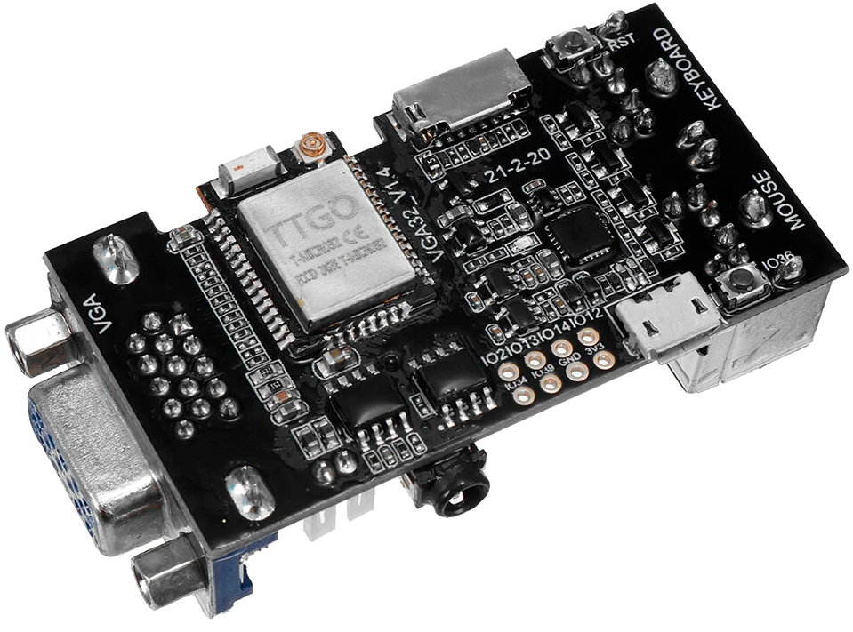
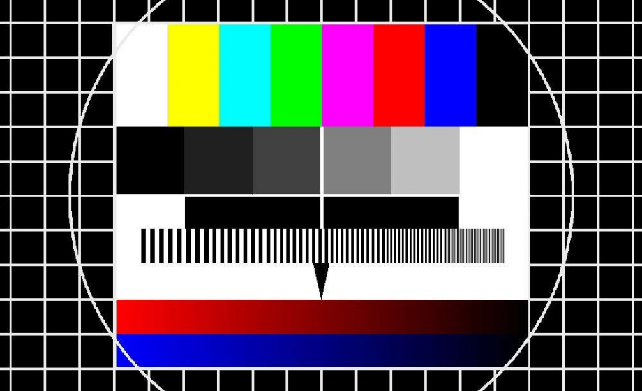

# Testimage generator for LilyGO VGA32 board

This project is a VGA Mode test pattern generator for the [LilyGO VGA32](https://lilygo.cc/en-us/products/fabgl-vga32) board, using the [FabGL library of Fabrizio Di Vittorio](https://github.com/fdivitto/fabgl).

 


It is based on [ModelineStudio](https://github.com/fdivitto/FabGL/tree/master/examples/VGA/ModelineStudio) sample of the [FabGL](https://github.com/fdivitto/FabGL) library with some additional features:
- typical retro TV-like test image generation
- all [supported VGA Modes](https://github.com/fdivitto/FabGL/blob/master/src/fabglconf.h#L172-L324) \
  (16 colors by default (may be reduced on higher resolutions due to ressource limits))
- next Video mode selection on PROG Button press
- transferred to [PlatformIO](https://platformio.org)
- [VisusalStudio Code](https://code.visualstudio.com) setup using [PlatformIO IDE](https://github.com/platformio/platformio-vscode-ide) extension


## Setup

### with VisualStudio Code

Clone this repo (or unpack the compressed folder) and open it by one of these methods:
- open the project by double-click on [vs.code-workspace](vs.code-workspace)
- open a terminal and enter
   ```
   code <path to the folder of this project>
   ```
- right-click on this folder and select `Open with VisualStudio Code` from the context menu

This will
1. Open VisualStudio Code
2. Install the [required extensions](.vscode/extensions.json)
3. Setup PlatformIO with the [required libraries](platformio.ini)

### from Console

Typical commandline sequence to setup platformio on your host system:
```
# get installer script (see https://docs.platformio.org/en/latest/core/installation/methods/installer-script.html)
wget https://raw.githubusercontent.com/platformio/platformio-core-installer/master/get-platformio.py

# run installer script with python and add platformio core folder to PATH
python3 get-platformio.py
PATH=$PATH:$HOME/.platformio/penv/bin

# fetch this repository and enter the cloned folder
git clone <url of this repo>
cd <cloned repo folder>
```

## Build
Simply build the project by one of these options:
- click on the `PlatformIO::Build` icon in the bottom status line of VisualStudio Code
- press `Ctrl-Shift-B`
- select `Run Build Task` from the `Terminal` menu
- select `Run Task` from the `Terminal` menu and select `PlatformIO::Build`
- open a terminal (e.g. by selecting `New Terminal` from the `Terminal` menu) and enter
  ```
  pio run
  ```
  If this is executed the first time (in a shell environment only) PlatformIO will automatically fetch all required depoendencies.

## Flash
Make sure you have the VGA32 board connected via USB cable to your host computer and the [udev rules](https://docs.platformio.org/en/stable/core/installation/udev-rules.html) are installed.

Simply flash the project by one of these options:
- click on the `PlatformIO::Upload` icon in the bottom status line of VisualStudio Code
- select `Run Task` from the `Terminal` menu and select `PlatformIO::Upload`
- open a terminal (e.g. by selecting `New Terminal` from the `Terminal` menu) and enter
  ```
  pio run -t upload
  ```

## Links
- Original [LilyGO VGA32 board](https://lilygo.cc/en-us/products/fabgl-vga32)
- Official [LilyGO FabGL](https://github.com/LilyGO/FabGL) repo (with schematics)
- More recent [fdivitto/FabGL](https://github.com/fdivitto/fabgl) repo and [project page](https://www.fabglib.org) by Fabrizio Di Vittorio
- A [collection of applications](https://github.com/fdivitto/FabGL/wiki/Made-with-FabGL) using the FabGL library
- list of [TTGO-VGA related stuff](https://github.com/iandstanley/awesome-ttgo-vga)
- my favorite [case](https://www.thingiverse.com/thing:4570375) for the VGA32 board
